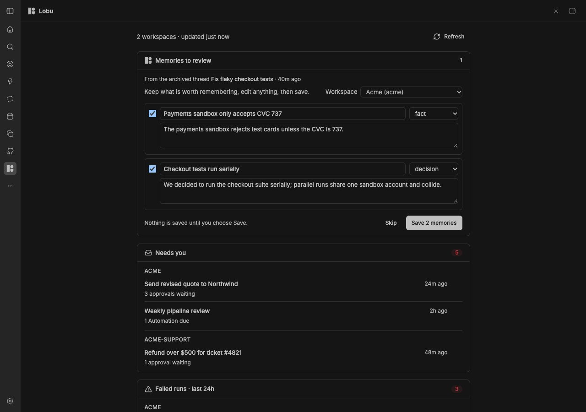
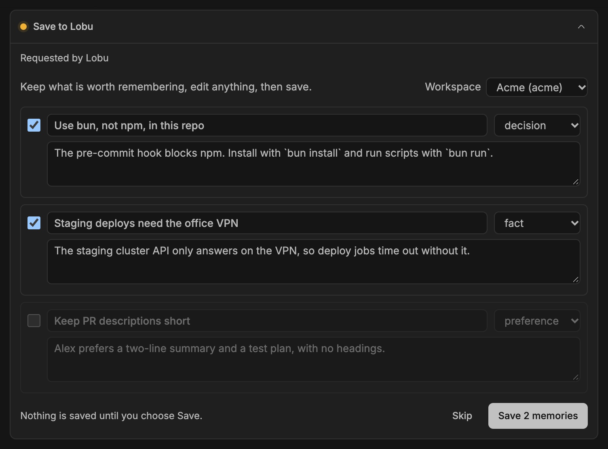

# Lobu for bb

A [bb](https://getbb.app) plugin that shows what needs you across your
[Lobu](https://lobu.ai) workspaces, and saves what your agents learn to Lobu
memory, without leaving bb.



## What you get

A **Lobu** page in the bb sidebar. It opens on the Lobu web app itself, signed
in with your `lobu` CLI login, the way the Lobu Mac app shows it. When the CLI
has more than one context, a picker above the app switches between them. The
Lobu server has to allow bb's address to frame it; see [Notes](#notes).

The **Needs you** tab covers every workspace your `lobu` CLI
logins can reach. A row of workspace chips at the top narrows the page to one
workspace (the choice is remembered), and the cards are grouped by workspace:

- **Needs you**: pending approvals and Automations that are due. Identical
  requests collapse into one row ("36 approvals waiting") that links to all of
  them. Approvals older than the newest 50 activity items are counted in an
  "Older approvals" row.
- **Failed runs**: Automation and feed failures from the last 24 hours.
  Failed ad-hoc agent tool calls are left out.
- **Connections & devices**: connections and feeds that need attention, and
  paired devices that are offline, erroring, or need an update.
- **Activity**: agent briefings, the busiest feeds by items synced, and
  Automation runs over the last 24 hours.
- **Metrics**: metric queries you pin, plus the measures each workspace
  declares.

Every row links to Lobu. Hover a row and choose **Ask an agent** to open
bb's New thread screen with a prompt about it; you pick the project and send.

A one-line summary also appears on the New thread screen when something needs
you.

## Memory

Agents in bb forget everything when a thread ends. The plugin keeps the
useful parts in your Lobu memory and hands them back to the next thread, so
a gotcha found once is not rediscovered every week.

It works as a loop:

- **Threads start with their project's brief.** Every new thread gets a short
  section with what you pinned to its bb project and what earlier threads
  there learned, most used first. It stays under bb's 4,096-character limit
  for plugin instructions.
- **Agents search before they work.** A `lobu_search` tool searches your
  personal workspace and the Lobu workspace you linked to the project. Only
  saved memories come back, not browser history or other connector content.
- **Agents save what they learn.** A `lobu_remember` tool saves decisions,
  non-obvious facts, and standing preferences, at most three at a time and
  each with an evidence quote. With **Save memories automatically** on (the
  default), they go straight to your personal workspace, and anything Lobu
  already holds is skipped. With it off, a review form opens first.

You see all of it in two places:

- **The thread's Lobu memory panel.** Open it from the side panel's new-tab
  menu. It shows what the thread started with, what the agent looked up, and
  what it saved. Every saved memory can be undone or pinned to the project.
- **The Memory tab of the Lobu page.** It lists recent saves with the same
  actions and how often agents have found each one since. It also lists
  every bb project with its linked workspace, its pins, a box to add a note
  every new thread should know, and the exact brief its threads start with.

Both places show a project through the same view. Undo hides the memory with
Lobu's own delete, which keeps it recoverable in Lobu. To move or edit a
memory, open it in Lobu.

You can still save by hand. Hover any message and choose **Save to Lobu**, or
highlight part of an answer and pick **Save to Lobu** from the selection
menu; a review form opens with that text. **Save learnings to Lobu** in the
thread's ⋯ menu asks the agent to look back over the thread.



**Recap archived threads**, off by default, has a hidden agent read each
thread you archive. Its memories are saved like any other when auto-save is
on, and otherwise wait on the Memory tab for review. Each recap is one agent
turn; set **Recap provider** and **Recap model** to a small, cheap model.

Agents pick up new tools and the brief when their session starts, so threads
that were already open before you installed or updated the plugin need a new
thread first.

## Requirements

- bb 0.46 or newer.
- The Lobu CLI, logged in:

  ```sh
  npm install -g @lobu/cli
  lobu login
  ```

## Install

```sh
bb plugin install git:https://github.com/lobu-ai/bb-plugin-lobu.git
```

## How it talks to Lobu

The plugin reuses your `lobu` CLI logins. bb opened from the Dock does not
see your shell's `PATH`, so the plugin reads `PATH` once from your login shell
and runs the CLI with it, the same way your terminal does. It runs `lobu context list --json`
and keeps every context that is logged in to the configured Lobu URL. For each
one it runs `lobu token --raw`, asks Lobu which workspaces that login covers, and
makes one read-only `query_sdk` call per workspace. The summary is computed
inside Lobu, so only the rows the page shows come back. Results are cached for
a minute and the page refreshes every two minutes.

Memory writes use Lobu's own tools: `save_memory` to save, and `run_sdk` with
`knowledge.delete` to undo. Searches use
`search_memory`. What the plugin saved, project links, pins, and each
thread's log stay in the plugin's bb storage. Recaps read the archived thread through bb's
own thread API and keep their proposals in the plugin's bb storage until you
review them. CLI tokens stay in the bb server process. The page receives
summaries, the form's contents, and, for the embedded app, a Lobu web session
the server mints with Lobu's `/api/extension-session`, the route Lobu's Chrome
extension and Mac app use. The session reaches the frame in the URL fragment,
which is never sent to a server, and Lobu's bootstrap page removes it from
history before signing the frame in.

## Settings

Open them in bb under Settings → Plugins → Lobu, or use `bb plugin config lobu`.

| Setting | Default | Description |
|---|---|---|
| `hiddenWorkspaces` | empty | Comma-separated workspace slugs to leave out. |
| `metrics` | `[]` | JSON array of metric queries, for example `[{"workspace":"acme","entity_type":"company","measure":"spend","by":["month"],"label":"Spend by month"}]`. |
| `baseUrl` | `https://app.lobu.ai` | Change only for a self-hosted Lobu. |
| `lobuBin` | empty | Path to the `lobu` CLI. Empty tries `~/.bun/bin/lobu`, then `lobu` on your login shell's `PATH`. |
| `autoSave` | `true` | Save what agents learn to your personal workspace without asking. Off opens a review form for every save. |
| `recapOnArchive` | `false` | Recap threads when you archive them, saved like other memories when auto-save is on, otherwise queued for review. |
| `recapProvider` | empty | Provider id for recaps, such as `acp-opencode`. Empty uses the archived thread's provider. |
| `recapModel` | empty | Model for recaps. Empty uses the provider's default. |

## Notes

- The page shows the workspaces your CLI logins cover, nothing more. Each
  login only covers the workspaces you approved when you ran `lobu login`. If
  one is missing, run `lobu login` again and approve it, or log in another
  context with `lobu context add <name> --url https://app.lobu.ai/api/v1` and
  `lobu login --context <name>`; it shows up on the next refresh.
- Reading every login needs a Lobu CLI with `lobu context list --json`. An
  older CLI shows only its active context's workspaces.
- The embedded app needs the Lobu server to allow bb as a frame ancestor.
  Lobu sends `frame-ancestors` from its `FRAME_ANCESTORS` setting, so a
  self-hosted Lobu adds bb's address there, for example
  `http://127.0.0.1:38886`. Until it does, the frame shows the browser's
  blocked-page icon; **Open in browser** still works.
- "Items synced" counts every item a feed run fetched, including ones it had
  already seen, so it measures sync volume rather than new data.
- The 24-hour activity scan reads at most the newest 3,000 feed runs per
  workspace and says so when it hits that cap.
- "Needs you" groups the 50 newest activity items per workspace, the largest
  page Lobu returns, and counts every pending approval separately so none are
  missed.

## Development

```sh
bun install
bun test             # unit tests, including the script Lobu runs
bun run typecheck
bun run build        # regenerates lib/lobu-scripts.generated.ts, then bb plugin build
bb plugin install .  # path install for live testing
```

`lib/workspace-summary.ts` holds the code that runs inside Lobu. It must stay
self-contained. `bun run generate` turns it into the plain JavaScript in
`lib/lobu-scripts.generated.ts`, and a test fails when that file is stale.

## License

Apache-2.0
