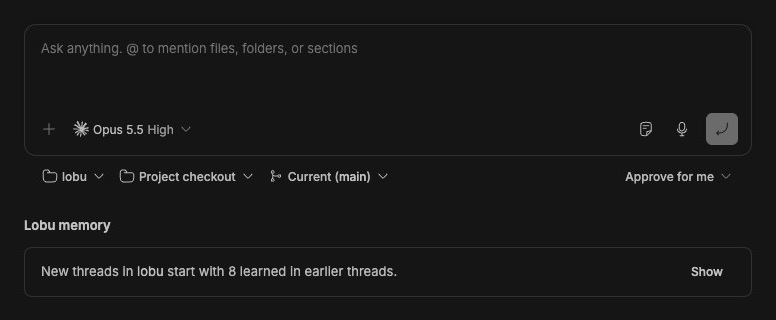
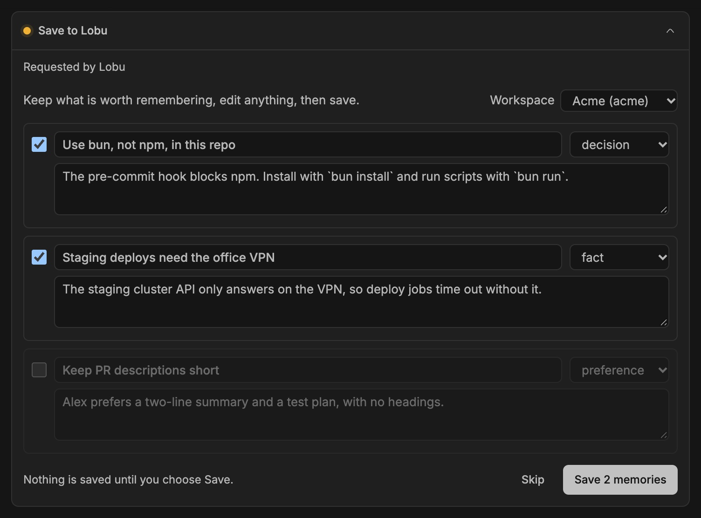

# Lobu for bb

A [bb](https://getbb.app) plugin that saves what your agents learn to
[Lobu](https://lobu.ai) memory and hands it back to the next thread.

## Getting connected

After you install the plugin, a **Connect Lobu memory** card on bb's New
thread screen walks you through setup, one button at a time:

1. **Install the Lobu CLI.** The plugin talks to Lobu through the `lobu`
   CLI. If bun or npm is on your login shell's `PATH`, the button runs
   `bun add -g @lobu/cli@^24` (or `npm install -g @lobu/cli@^24`), never
   with sudo, then checks that `lobu --version` runs. If that fails, or
   neither tool is found, the card shows the command to run yourself and a
   **Check again** button. An older CLI gets an **Update** button instead.
2. **Choose where your memory lives**, as in the Lobu Mac app. The card shows
   a collapsible **CONTEXT** section listing the `lobu` CLI contexts it
   already knows — one row per context with its name and origin, a checkmark
   on the login bb uses, and a "Signed in" badge on the others that are
   ready. (Open while bb is not connected; tucked away once it is.)
   Clicking a row switches bb to it, signing in or starting it when needed.
   Add a new context with `lobu context add` in a terminal; the card picks
   it up.
   - **Use Lobu Cloud** appears only when no Cloud login exists yet. Otherwise
     pick a Cloud row: it reuses that login, signing in there when needed,
     which opens Lobu's approval page in your browser. You can create a Lobu
     account there too. The card updates once you approve.
   - **Run Lobu on this machine** appears only when no local Lobu exists yet.
     Otherwise the local row starts it: it uses a local Lobu that is already
     serving (the Mac app's, or your own `lobu run`) through the `local` CLI
     context, or starts `lobu run` in `~/lobu-bb`, a project whose `.env`
     holds the key Lobu encrypts stored secrets with, and stops it when bb
     stops. `lobu run` signs the `local` context in by itself. The Mac app's
     own project (`~/lobu`) keeps its key in the Keychain, so bb never starts
     it: open the Lobu app instead.
3. The card disappears once bb is connected.

The same steps live on in Settings → Plugins → Lobu, in a **Lobu account**
section: which Lobu bb uses, who it is signed in as, the workspace agents
save to, and how many memories bb has saved there, with a link to them. It lists every CLI context bb knows, like the Mac app's CONTEXT section, so switching is one click. Add a new context with `lobu context add` in a terminal; the plugin picks it up on its next check.

## The Lobu page

**Lobu** in bb's sidebar is a page for the login bb uses:

- **Inbox** — unread Lobu notifications, newest first, with **Open** and
  **Mark read**. The first five stay in view and **Show all** unfolds the rest.
- **Memories** — **Saved from bb** (the default) lists what agents saved in
  bb threads, with the project, how often search has reused it, and links to
  the Lobu event and the source thread. **All of Lobu** searches across every
  workspace the login reaches, filtered by workspace, memory kind, and time
  window (24h, 7 days, or 30 days).
- **Devices and connections** — paired devices with their online state, plus
  the connections that report an error or a broken status, with **Manage in
  Lobu** for the rest.

The header names the account and the Lobu bb talks to, and a **context
picker** switches the login bb uses without leaving the page — the inbox,
memories, connections, and bb's own saves and searches all follow it.
**Open in browser** opens the personal workspace. Each section loads on its
own, so a slow or failing Lobu call leaves the rest of the page usable.

## Memory

Agents in bb forget everything when a thread ends. The plugin keeps the
useful parts in your Lobu memory and hands them back to the next thread, so
a gotcha found once is not rediscovered every week.

When bb is connected, the New thread screen also shows your **Inbox**: unread
Lobu notifications in the login's personal workspace, newest first, with an
**Open** link into Lobu and **Mark read** per item. It stays quiet when there
is nothing to show.

It works as a loop:

- **Threads start with their project's brief.** Every new thread gets a short
  section with what you pinned to its bb project and what earlier threads
  there learned, most used first. When a project is linked to a team Lobu
  workspace, saved memories from that workspace join the brief too, and edits
  or deletes made in Lobu sync back into bb. The brief stays under bb's
  4,096-character limit for plugin instructions.
- **Agents search before they work.** A `lobu_search` tool (and `bb lobu search`
  CLI command for ACP providers that do not expose plugin tools) searches your
  personal workspace and the Lobu workspace you linked to the project, returning
  saved memories and the entities the query names, with their IDs. Only
  saved memories come back, not browser history or other connector content.
- **Agents save and supersede what they learn.** A `lobu_remember` tool (and
  `bb lobu remember` CLI command) saves decisions, non-obvious facts, and
  standing preferences, at most three at a time and each with an evidence
  quote. Each memory is linked to Lobu entities only on certain evidence: the
  full names the agent lists in `mentions` (`--mentions`) when exactly one record
  in the destination workspace has that name (Lobu resolves it when the memory
  is saved), and explicit `entityIds` that are records there. The project's
  repository is one such mention, listed only when the memory is about that
  codebase or product. Partial names, shared names, and member records are
  never linked, and the agent is told which mentions stayed unlinked and why.
  This needs a Lobu server whose save_memory accepts names in `entity_ids`. The plugin never
  creates entities. Passing `replacesEventId` (`--replaces-id`) supersedes an outdated
  memory instead of leaving both active. With **Save memories automatically**
  on (the default), saves go straight to your personal workspace, and anything
  Lobu already holds is skipped. With it off, a review form opens first.

You see it in the thread's **Lobu memory panel**. Open it from the side
panel's new-tab menu. It shows what the thread started with, what the agent
looked up, and what it saved. Every saved memory can be undone, pinned to the
project, or shared in one click to the project's linked team workspace. The
panel also shows the project's linked workspace, its pins, a box to add a note
every new thread should know, and the exact brief its threads start with —
with remove controls on both pinned and learned rows. Undo hides the memory
with Lobu's own delete, which keeps it recoverable in Lobu. To edit a memory,
open it in Lobu.

Before a thread exists, bb's New thread screen shows the same brief for the
project picked in the composer: one line saying what a new thread there will
start with, which opens the same project controls. Threads started with
"Don't work in a project" share bb's Personal project brief.



To see everything bb saved, choose **See everything bb saved in Lobu** in the
panel, or **Open what bb saved in Lobu** in the thread's ⋯ menu. Both open
Lobu's events page filtered to those memories, in bb's browser or yours,
following your bb browser setting.

You can still save by hand. Hover any message and choose **Save to Lobu**, or
highlight part of an answer and pick **Save to Lobu** from the selection
menu; a review form opens with that text. **Save learnings to Lobu** in the
thread's ⋯ menu asks the agent to look back over the thread.



**Recap archived threads**, off by default, has a hidden agent with the
archived thread's own provider read each thread you archive and save its
memories like any other. It needs auto-save on, since nobody reviews a form in
an archived thread. Each recap is one agent turn.

Agents pick up new tools and the brief when their session starts, so threads
that were already open before you installed or updated the plugin need a new
thread first.

## Mentioning Lobu things in chat

Type `@` in any bb composer to reference Lobu without pasting: saved
memories, entities, feeds, automations, paired devices and connections, and open
browser tabs each get their own menu section. Picking one inserts a pill;
at send time the plugin resolves it into fresh agent-only context (the full
memory text, entity metadata and view link, a feed or automation status summary, a device or connection
status, the tab's title and URL, and the visible text of the page). Resolving
never blocks the send on a stale reference — an unreachable item degrades to
a short note instead. Each resolve refreshes for at most 1.5 seconds and falls
back to what the @ menu already knows, since Lobu's feed list alone can take
seconds. Reading a tab's text is read-only and bounded; if the
browser is asleep or the page refuses, the reference falls back to its title
and URL.

## Requirements

- bb 0.46 or newer.
- bun or npm, so the plugin can install the Lobu CLI for you. Without either,
  install `@lobu/cli` yourself.

## Install

```sh
bb plugin install git:https://github.com/lobu-ai/bb-plugin-lobu.git
```

## How it talks to Lobu

The plugin uses one `lobu` CLI login: the context picked in the Lobu account
section (kept in the plugin's bb storage), or the CLI's active context until
you pick one. It runs `~/.bun/bin/lobu`, else the first `lobu` on your login
shell's `PATH`. bb opened from the Dock does not
see your shell's `PATH`, so the plugin reads `PATH` once from your login shell
and runs the CLI with it, the same way your terminal does. It reads the
context's Lobu URL from `lobu context list --json`, and who it is signed in
as, its workspaces, and its token from `lobu whoami --json --include-tokens`,
the same source the Lobu Mac app reads. A Lobu on this machine takes the
worker token its `lobu run` minted.

Memory writes use Lobu's own tools: `save_memory` to save or supersede, and
`run_sdk` with `knowledge.delete` to undo. Searches use `search_memory`, and
`read_knowledge` reconciles edits and deletes made in Lobu and hydrates saved
memories from linked workspaces. What the plugin saved, project links, pins,
and each thread's log stay in the plugin's bb storage. Recaps read the archived
thread through bb's own thread API. CLI tokens stay in the bb server process;
the page never receives one. "Open in Lobu" links to Lobu's events page
filtered by the ids of the memories bb saved (`content_ids`), so it shows them
to whoever is signed in to Lobu in that browser.

## Settings

Open them in bb under Settings → Plugins → Lobu, or use `bb plugin config lobu`.

| Setting | Default | Description |
|---|---|---|
| `autoSave` | `true` | Save what agents learn to your personal workspace without asking. Off opens a review form for every save. |
| `recapOnArchive` | `false` | Recap threads when you archive them, with the thread's own provider, and save what they learned. Needs `autoSave`. |

## Notes

- Memory uses the workspaces the login bb uses covers. Each login only covers
  the workspaces you approved when you signed in. If one is missing, sign in
  again and approve it.
- Switching logins needs CLI 24 or newer (`lobu context list --json`). With an
  older CLI the plugin uses its active context on `https://app.lobu.ai`, and
  the setup card offers an update.

## Development

```sh
bun install
bun test
bun run typecheck
bun run build        # bb plugin build
bb plugin install .  # path install for live testing
```

## License

Apache-2.0
